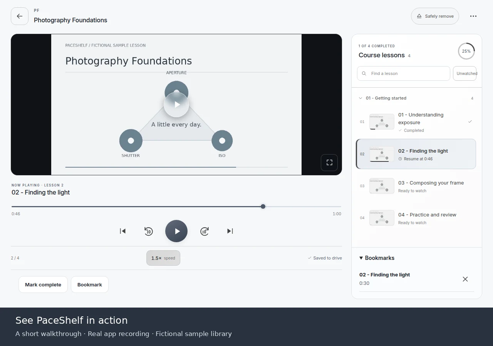
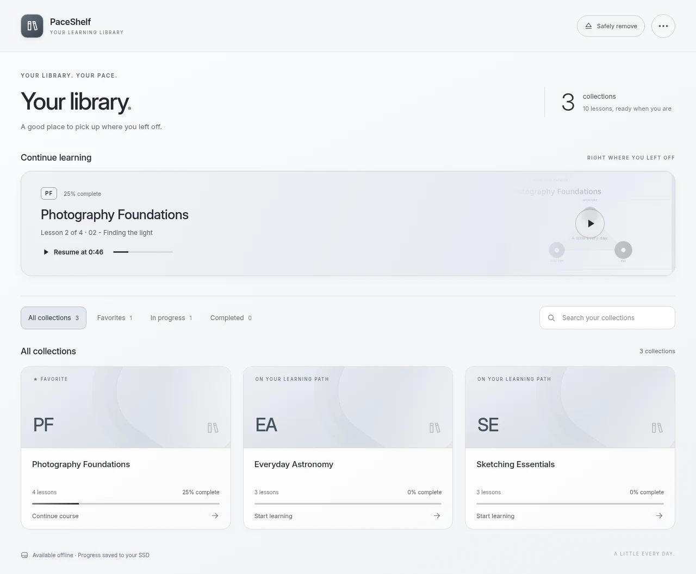
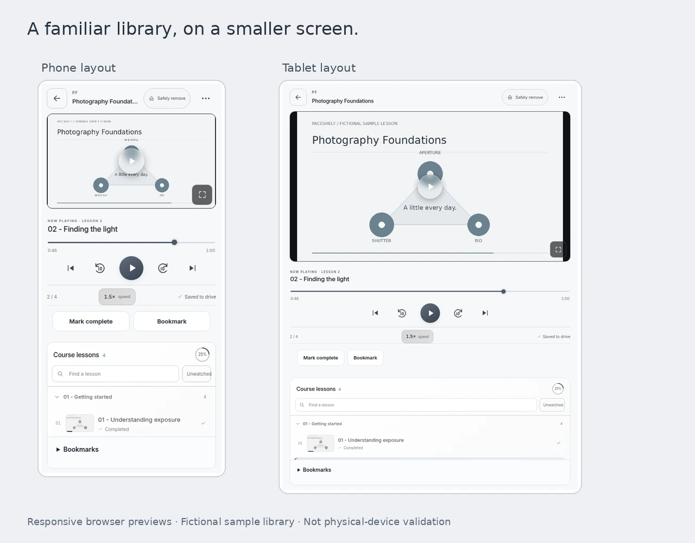
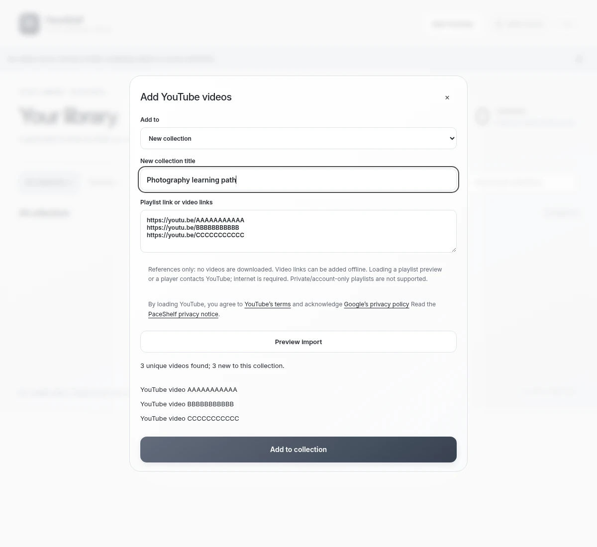

# PaceShelf

**Your learning library. Your pace.**

Turn a folder of your own videos into an organized learning library. Resume lessons,
adjust playback speed, save bookmarks and track what you have finished — on Android
or Ubuntu, with no account or hosted service required. Add YouTube video links or
public/unlisted playlists alongside your personal files; YouTube playback needs internet.

**[Download for Android](https://github.com/jayelbotvibe-web/paceshelf/releases/download/v0.2.0-preview/PaceShelf-0.2.0-preview-debug.apk)**
&nbsp; · &nbsp;
**[Download for Ubuntu](https://github.com/jayelbotvibe-web/paceshelf/releases/download/v0.2.0-preview/paceshelf_0.2.0-preview1_amd64.deb)**
&nbsp; · &nbsp;
[Installation guide](docs/INSTALL.md)
&nbsp; · &nbsp;
[All downloads](https://github.com/jayelbotvibe-web/paceshelf/releases/tag/v0.2.0-preview)

> **Development preview · 0.2.0.** Update every device before using YouTube metadata. Suitable for trying the project with backed-up
> videos and metadata. Physical USB handoff, battery use and broader codec support
> still need validation. The Android APK is debug-signed; export a metadata backup
> before a future signing change. [Known limitations](#compatibility-and-preview-limits).

## See it in action

**[Watch or download the short walkthrough (MP4)](https://github.com/jayelbotvibe-web/paceshelf/releases/download/v0.1.0-preview/PaceShelf-Walkthrough.mp4)**
— a silent, captioned recording of the 0.1.0 local Ubuntu player. It shows resuming a
lesson, changing speed, bookmarking, completion with undo, and storage settings.
[Read the walkthrough](docs/DEMO.md) for the same steps without video.

All examples are fictional. Application downloads contain no course videos or
personal viewing history.

## Make steady progress

| What you want to do | What PaceShelf offers today |
| --- | --- |
| Bring YouTube into your collection | Paste video links or preview a public/unlisted playlist; add to a new or existing collection |
| Find your next lesson | Collections, search, favorites and Continue learning |
| Watch at your own pace | Remembered position and speed, seeking, previous/next and optional auto-next |
| Know what you have finished | Explicit lesson completion, collection progress and undo |
| Revisit a useful explanation | Timestamp bookmarks with jump and delete |
| Organize your material | Custom collection/lesson titles, section labels and ordering without renaming files |
| Keep control of your history | Device-only or portable storage, metadata backups and conflict review |

<strong>Your library at a glance</strong>

<strong>Phone and tablet layouts</strong>

Responsive browser captures of the shared interface. Android uses a native app
with the system folder picker; these images do not establish physical-device testing.

## Get started

1. **Install PaceShelf** using the [Android or Ubuntu guide](docs/INSTALL.md).
2. **Choose your video folder.** Videos can be on the device or an accessible USB
   drive. Subfolders become collections; videos directly in the chosen folder work too.
3. **Choose where progress is saved** in **Library settings → Save library metadata**.
4. **Open a collection and play.** Return to Continue learning when you come back.

Ubuntu opens the player in your browser through a local launcher. There is no
publicly hosted player to upload your library to, and no server account to create.

## Add YouTube to a collection

1. Select **Add YouTube**. Give a new collection a title or choose an existing one.
2. Paste **one playlist link**, or **one video link per line**, then select **Preview import**.
3. Review the IDs and number of new videos, then select **Add to collection**.
4. Open a lesson and select **Load YouTube player**. Use YouTube’s play button.
   The official player retains its controls, captions and attribution.

On Android, **Start a device-only YouTube library** works without a drive or folder
grant. On Ubuntu, choose an existing library folder or an empty folder in the launcher.
Online lessons can share a collection with local files. Completion, bookmarks and
saved positions use the same library and progress-sharing modes.

No API key, account login, video downloader or maintainer-run proxy is required.
Playlist discovery uses the official player’s available video list (up to 500 items);
private, unavailable or omitted videos may be missing. Initial labels use video IDs;
you can rename them in Edit collection. **Review playlist updates** appends new videos
without resetting progress or your ordering. There is no automatic background playlist sync.

[YouTube instructions, privacy and limitations](docs/YOUTUBE.md).

<strong>YouTube import preview</strong>

Fictional references illustrate the import flow; they are not playable sample courses.

## Take progress to another device

| Storage choice | Where progress is saved | How you move it |
| --- | --- | --- |
| **On this device** | This installation's app data | Export a library backup, transfer it, then review and restore it on the other device |
| **Portable library** | A checked copy in the video folder's hidden `.paceshelf` folder, with a local recovery copy | Use PaceShelf on each device and connect the same drive |

**There is no automatic cloud synchronization.** Separate video copies do not share
progress on their own. Metadata backups contain collections, progress and bookmarks;
they **do not include your videos**.

For portable use:

1. Choose the **same video-library folder** on each device and select **Portable library**.
2. Pause playback and confirm that saving to the drive succeeded. **This device only**
   means the shared drive has not received the latest progress.
3. Use **Safely remove**, then finish the operating system's unmount/eject step
   before unplugging. Android's button prepares the app; it does not unmount USB storage.
4. Connect the drive to the next device, grant folder access and open or refresh the library.

Keep the entire `.paceshelf` folder if you copy a library. Use one device at a time;
simultaneous/network-mounted libraries are unsupported. Keep an independent backup.

## Compatibility and preview limits

| Platform or source | Current status |
| --- | --- |
| Android | Android 9 or newer; current Android System WebView; grant access with the folder picker |
| Ubuntu x86_64 / AMD64 | `.deb` and portable archive; local launcher opens a compatible browser |
| Ubuntu ARM64 | Binary in the portable archive; cross-compiled, hardware testing outstanding |
| Personal local videos | MP4 and WebM are good starting points; playback depends on the actual codec and device/browser |
| External USB storage | The OS must recognize the drive and allow folder access; portable progress also requires write access |
| YouTube | Official embedded player, online only; public/unlisted references, with per-video resume and completion |
| Other streaming services, Windows, macOS and iOS | Not supported in this preview |

Renamed/moved videos are not automatically relinked. Multiple-library management,
import preview for local first discovery, richer recovery tools and additional online sources remain
planned. Verified metadata saves help detect incomplete writes; they cannot prevent
drive failure or guarantee against corruption. See [implementation status](docs/IMPLEMENTATION.md)
and [what was tested](VERIFICATION.md).

## Questions and help

**Why did my progress not appear on another device?** Check the storage mode, choose
the same library folder, and verify a drive save before unplugging. Device-only
history needs manual backup transfer. Regrant folder access on the receiving device.

**Does PaceShelf include courses or download videos?** No. Supply videos you are
entitled to use. YouTube links use its official player and require internet; other
streaming services are not implemented.

**Do I need sudo on Ubuntu?** Package installation may require administrator access.
Run PaceShelf as your normal user; do not run `start.sh` with sudo.

**Is my history private?** There is no hosted sync service or PaceShelf account. Loading
a YouTube preview/player contacts YouTube and is subject to its terms and Google’s
privacy policy. Local browsing does not load YouTube. Metadata is
stored as plaintext and may contain your video titles and viewing history. Keep
backups private and remove identifying information from screenshots and bug reports.

**Found a problem?** [Report a bug](https://github.com/jayelbotvibe-web/paceshelf/issues/new?template=bug_report.yml)
or [suggest an improvement](https://github.com/jayelbotvibe-web/paceshelf/issues/new?template=feature_request.yml).
Include the app version, platform and steps to reproduce with fictional examples.

## Contribute and learn more

[Contributing and building](CONTRIBUTING.md) · [Testing](TESTING.md) ·
[Product roadmap](docs/PRODUCT-PLAN.md) · [Risk review](docs/PLAN-REVIEW.md) ·
[Storage design](docs/STORAGE.md) · [Publishing safely](PUBLISHING.md)

Free and open source under the [MIT license](LICENSE). Inter uses the
[SIL Open Font License](app/src/main/assets/fonts/OFL.txt); see
[third-party notices](THIRD-PARTY-NOTICES.md) for other components.
